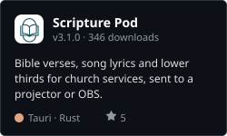
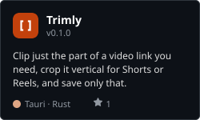
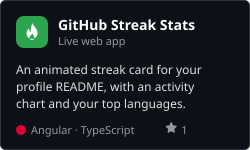

# 🎹 Joshua Pavan

Senior software engineer working in Angular, .NET and AI-assisted engineering: agents, skills and MCP servers. On the side I build [Scripture Pod][scripture-pod] for churches, and post it alongside piano and guitar on [YouTube][youtube].

   

      
      
      
      
   

---

### 🧰 Languages and Tools

#

### 🚀 What I'm Building

<!-- Cards are drawn by .github/scripts/profile_assets.py; stars, versions and downloads refresh daily. -->

#

### 📺 Latest YouTube Videos

<!-- BEGIN YOUTUBE-CARDS -->

<!-- END YOUTUBE-CARDS -->

#

### 🔥 GitHub Streak

Want one on your own profile? Enter your username, pick a theme and layout, then paste the Markdown into your README. It takes under a minute.

#

 
<b>👨‍💻 More about me</b>

 

- Senior Software Engineer at **Magic EdTech** (Sept 2024 to now): .NET services built from scratch with clean architecture, Angular micro-frontends, SQL Server tuning, and AI workflows with custom agents, skills and MCP servers. Started there on Rails and React monoliths.
- Software Engineer at **CognitiveClouds** (Feb 2022 to Sept 2024): Rails, Spring Boot and React APIs, Selenium test automation and release deployments.
- Based in Bengaluru, India. Pianist, guitarist and music producer.
- Say hi at [joshuapavan35@gmail.com](mailto:joshuapavan35@gmail.com).

[youtube]: https://www.youtube.com/@joshuapavan
[scripture-pod]: https://scripture-pod.vercel.app/
[portfolio]: https://joshuapavan.vercel.app
[linkedin]: https://www.linkedin.com/in/pavan-kumar-g-906a/
